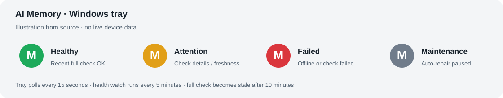
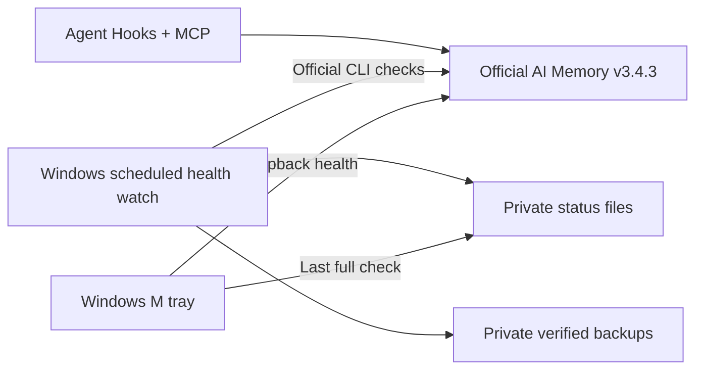

# AI Memory · Windows 定制版

为原生 AI Memory 增加 **Windows 状态托盘、独立巡检、私密验证备份和更新保护**。

这是 [akitaonrails/ai-memory](https://github.com/akitaonrails/ai-memory) 的公开 fork，定制基于官方 **v3.4.3**。保留上游完整源码及 MIT 许可证；新增功能位于 [`companions/ai-memory-windows`](companions/ai-memory-windows)，核心 Rust 程序沿用上游版本。

**[安装与使用](companions/ai-memory-windows/README.md) · [验证记录](companions/ai-memory-windows/VALIDATION.md) · [原版 README](README.upstream.md) · [上游变更](CHANGELOG.md)**



上图是根据源码绘制的示意，不包含真实设备状态或个人记忆。

## 这个 fork 增加了什么

| 定制 | 用途 |
| --- | --- |
| **四色状态托盘** | 每 15 秒检查本机服务，结合完整巡检显示正常、待检查、故障或维护状态 |
| **独立 Windows 巡检** | 每 5 分钟检查服务、Hook、补传、模型任务及备份，按任务保留失败提示 |
| **验证备份与更新入口** | 每日在线快照和 SQLite 检查；更新前额外保留程序、定制、接线及认证快照 |
| **超大图片事件保护** | 先逐字节保留原件，再压缩已识别的内嵌图片块，保留事件身份并交给官方补传 |
| **可选模型入口辅助** | 独立 OAuth/自有 HTTPS 中转的测试、切换与后台核验，不预设私人模型或地址 |



图示说明组件关系。托盘呈现检查结果，知识库、MCP、事件补传和数据库写入由官方程序负责。

## 安装

面向 **Windows 10/11、Python 3.11+、已完成初始化的原生 AI Memory**。当前适配为单个本机安装、默认 `127.0.0.1:49374` 端口及 Codex Hook 检查。完整前提、路径参数和覆盖保护见[安装指南](companions/ai-memory-windows/README.md)。

在仓库根目录用 PowerShell 先预览：

```powershell
& '.\companions\ai-memory-windows\install.ps1' -Plan
```

核对路径后安装并登记登录启动：

```powershell
& '.\companions\ai-memory-windows\install.ps1' -RegisterStartup
```

安装器会限制数据和备份目录的访问权限。已有同名定制时会停止；应先备份并审阅差异。公开仓库只分发源码和示例配置，安装后产生的状态、凭据和快照继续保存在本机私密目录。

## 代码与个人数据的边界

- 源码使用当前用户环境和私密安装设置解析路径，无内置的个人目录、项目映射、中转站地址或账户凭据。
- 示例只含占位符，测试使用临时目录和合成事件；配图是示意图。
- 记忆数据库、Wiki、会话记录、状态报告、认证文件、密钥、备份及编译产物不属于本次分发内容，相关路径已加入忽略规则。

GitHub 公开的 fork 所有者及必要的上游作者、许可证信息仍然可见。`.gitignore` 不能清除已经提交过的内容；后续提交前仍需检查暂存区和历史。

## 验证

本次公开化验证范围见 [VALIDATION.md](companions/ai-memory-windows/VALIDATION.md)。回归命令：

```powershell
python -m unittest discover -s '.\companions\ai-memory-windows\tests' -v
```

Windows 登录启动、通知区显示、账户可用模型及未来上游版本需要在目标机器复核。托盘绿色表示已配置的检查通过，不代表记忆内容准确或所有场景均已验证。

## Upstream / English

This fork keeps the upstream v3.4.3 Rust server and adds an optional Windows companion for tray status, scheduled health checks, verified private backups, upgrade protection and bounded image-spool repair. Paths and provider settings are configurable; no installed memory store or credentials are distributed.

Read the [Windows companion guide](companions/ai-memory-windows/README.md) for prerequisites and installation, or the [original upstream README](README.upstream.md) for AI Memory itself.

Upstream: [akitaonrails/ai-memory](https://github.com/akitaonrails/ai-memory). License: [MIT](LICENSE). This fork is independently maintained.
