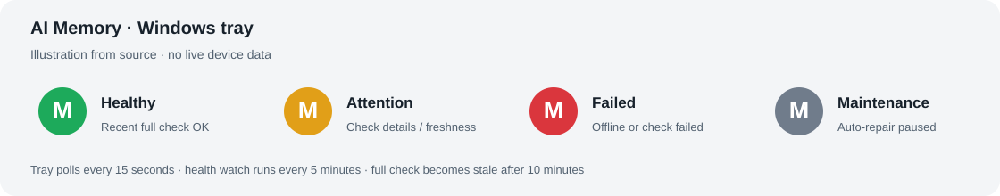
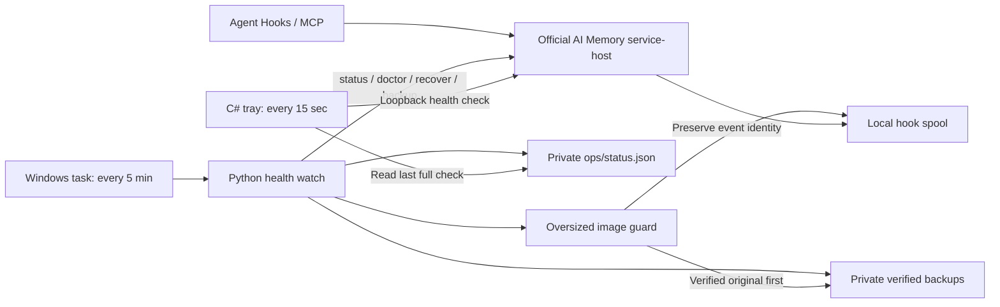

# AI Memory Windows companion

Windows 托盘、独立巡检、私密备份和安全更新脚本，适用于已有的 AI Memory 原生安装。基于官方 **v3.4.3**；核心 Rust 程序沿用上游。

This optional companion adds a Windows status tray, scheduled health checks, private verified backups and an upgrade wrapper. The Rust server stays at upstream v3.4.3. It is intended for one Windows user, one local installation and the default loopback port.

## 安装前确认

1. 已按[官方 Windows 文档](../../docs/windows.md)完成原生安装、初始化及所需的 Hook/MCP 接线；服务使用 `127.0.0.1:49374`。本组件不自动修改 Hook 信任或项目映射。
2. 使用 Windows 10/11、Windows PowerShell 5.1 或更高版本，以及带 `pythonw.exe` 的 **Python 3.11+**。托盘使用 Windows 的 .NET Framework C# 编译器构建，不需要 Rust 编译工具。
3. 备份目录与数据目录必须分开。安装器会将这两个目录及 `ops` 的访问权限限制为当前用户和 SYSTEM；这里保存的快照可能含认证材料。

在仓库根目录用 PowerShell 预览安装位置，下面每条命令均为一行：

```powershell
& '.\companions\ai-memory-windows\install.ps1' -Plan
```

默认数据位于当前用户的 Documents 下的 `ai-memory-data`，程序位于 LocalAppData 下的 `Programs\ai-memory`。可以用 `-DataDir`、`-Binary`、`-PythonExe`、`-BackupDir` 指定已有安装的位置。

只复制源码并编译托盘：

```powershell
& '.\companions\ai-memory-windows\install.ps1'
```

同时登记登录启动、每 5 分钟巡检任务、桌面入口，并启动服务和托盘：

```powershell
& '.\companions\ai-memory-windows\install.ps1' -RegisterStartup
```

已有 `ops/watch_ai_memory.py` 时，安装器会停止。先保存已有定制并核对差异，再决定是否加 `-Force`。它会拒绝覆盖属于另一安装位置的同名任务或托盘启动项。不要在不熟悉的现有数据目录上试装。

`-RegisterStartup` 使用当前登录用户、普通权限，不保存 Windows 密码。它是登录后运行的组件，不是无人登录时也运行的 Windows 系统服务。

## 看懂托盘



图为根据源码绘制的状态示意，未使用真实设备截图或运行数据。

| 状态 | 判定 |
| --- | --- |
| 绿色 | 本机健康端点可达，10 分钟内的完整巡检结果正常 |
| 黄色 | 服务在线，但巡检过期，或模型、Hook、补传、备份等检查有待处理项 |
| 红色 | 服务不可达，或完整巡检报告认证/检查失败 |
| 灰色 | `ops/maintenance.flag` 存在，自动恢复和备份暂停 |

托盘每 **15 秒**检查本机健康端点。双击显示本机 `status.txt`；右键可立即巡检、打开 Web UI 或私密备份目录。Windows 可能将图标放在隐藏通知区，通知也受系统设置影响。

退出托盘只关闭显示。巡检和记忆服务继续运行；下次登录或桌面 Tray 入口可重新启用图标。维护标记不是隐私开关：服务离线时 Hook 仍可能暂存事件。

## 各组件怎样协作



图示来自本目录源码。核心数据库写入和事件补传仍通过官方入口进行；诊断模块仅以只读方式查询任务归属。

## 保留的定制

| 文件 | 功能 |
| --- | --- |
| `ops/AI-Memory-Status.cs` | 四色托盘、菜单、过期检查提示 |
| `ops/watch_ai_memory.py` | 独立巡检、服务恢复、按任务告警、每日验证备份 |
| `ops/spool_image_guard.py` | 原件备份后压缩超大内嵌图片事件，再交由官方补传 |
| `ops/upgrade_snapshot.py`、`ops/update_ai_memory.ps1` | 更新前备份旧程序、定制、认证和接线，并核验核心数据库备份 |
| `ops/activate_*.py`、`ops/relay_diagnostics_gateway.py` | 可选模型入口切换及固定 HTTPS 路由的本机诊断 |

源码不预设个人用户名、项目作用域、中转地址或模型。安装器在私密安装目录生成 `windows-settings.json`；Python、PowerShell 和托盘从该文件读取路径。修改源码时保留 `ops` 的文件名及依赖关系。

### 超大图片事件保护

只处理默认本机服务的 Codex `post-tool-use`，触发阈值 **8 MiB**。仅替换识别到的内嵌图片块；普通文本、工具参数、事件去重键、项目身份和认证字段保留。`application/octet-stream` 还必须来自 `view_image`，并匹配支持的图片文件签名。

处理前取得 Windows 文件锁，将原始事件逐字节保存并校验，再原子替换。每轮最多 **8 项**、单项读取上限 **128 MiB**；原件归档达到 **2 GiB** 时停止自动处理并告警。未知事件保持原样，报告未处理原因。

### 备份和更新

每日备份调用官方在线快照，抽取其中数据库执行 SQLite `quick_check`，另存认证和接线补充包并检查 ZIP CRC。只清理本机制生成的、成组验证过的每日备份，保留最近 **7 组**；更新前快照另外保留。

备份可能含密钥、OAuth 认证和私人记忆。放在本机受保护的目录，不要上传到这个仓库。备份与源数据位于同一台机器，不能代替异机或离线副本。

指定版本更新，默认安装位置下可执行：

```powershell
& (Join-Path ([Environment]::GetFolderPath('MyDocuments')) 'ai-memory-data\ops\update_ai_memory.ps1') -Version 'v3.4.3'
```

请将版本参数改为已审查的目标版本。脚本先设置维护标记、生成并验证备份，再调用官方 `upgrade`、合作重启服务并核对版本。备份失败即停止，不强制结束未知进程。

`upgrade_snapshot.py` 的 ZIP 使用 `data/`、`program/`、`home/` 三个根，私密 `manifest.json` 记录对应的实际目录。回退时先另存升级后的新数据，合作停止服务，再恢复同一批次的数据库、Wiki、程序及接线；数据库已迁移时不能仅换回旧 exe。本组件没有一键自动回退。

### 可选：模型入口

不使用本节时，沿用官方已有 provider 设置。模型调用会消耗对应账户额度。

- **独立 OAuth**：先按官方 provider 文档登录。将 `examples/chatgpt-provider.example.toml` 复制到安装后的 `ops/chatgpt-provider.toml`，填写账户可用模型，再运行 `activate_chatgpt.ps1`。候选设置先做固定严格 JSON 测试，成功后才改配置并核验后台。
- **自有 HTTPS 中转**：将 `examples/relay-provider.example.toml` 复制到安装后的 `ops/relay-provider.toml`，填写实际 HTTPS 地址和模型。API key 单独保存在受保护的 `ops/relay-api-key.txt`，再运行 `activate_relay.ps1`。
- **按任务诊断**：创建 `ops/relay-diagnostics.enabled` 后重新执行中转激活入口。网关只监听 `127.0.0.1:49376`，只转发固定的 Chat Completions 路由，不跟随重定向。它记录有界、脱敏的任务错误，不保存请求正文。

示例域名和 `REPLACE_WITH_AVAILABLE_MODEL` 是占位符，不能当作已验证的可用服务。诊断错误仍可能包含项目名或上游返回的片段；这些本机文件和所有凭据都应继续私密保管。

## 验证与限制

在 Windows 上运行隔离回归：

```powershell
python -m unittest discover -s '.\companions\ai-memory-windows\tests' -v
```

测试覆盖图片原件保留、事件身份、未知输入不变、文件锁竞争、非零补传报告、可配置路径、只读数据库备份核验及 HTTPS 目的地址校验。测试使用临时目录和合成事件，不读写已安装的记忆数据库。

完整验证记录见 [VALIDATION.md](VALIDATION.md)。当前适配针对 v3.4.3、单个本机安装、默认端口和 Codex Hook 检查。尚未覆盖新 Windows 用户/空白电脑的完整部署、真实注销登录和其他上游版本；托盘颜色也不证明记忆内容准确或所有模型任务均已成功。

## 来源与许可

上游：[akitaonrails/ai-memory](https://github.com/akitaonrails/ai-memory)，基准标签 [v3.4.3](https://github.com/akitaonrails/ai-memory/tree/v3.4.3)。官方安装、模型、Hook 与 MCP 说明见[原版 README](../../README.upstream.md)。

本目录是 fork 的可选 Windows 定制，按仓库 [MIT 许可证](../../LICENSE)分发。保留上游作者及许可证声明，不代表上游官方提供支持。
